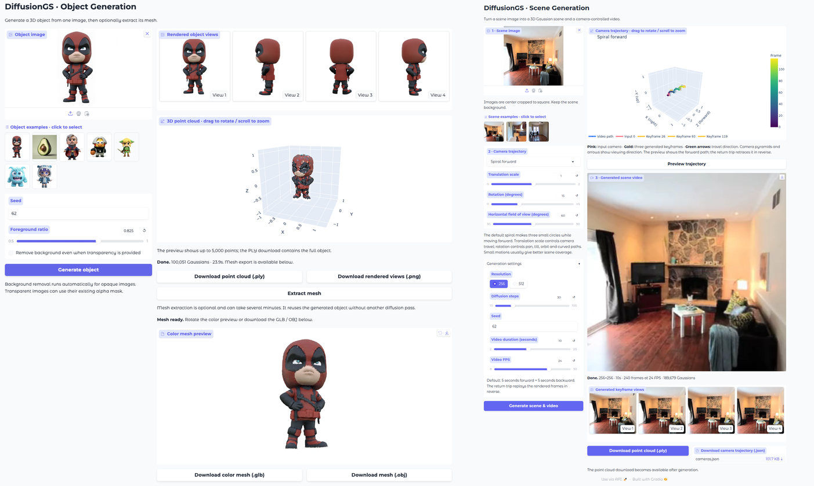

<div align="center">
<p align="center">  </p>

[](https://arxiv.org/abs/2411.14384)
[](https://zhuanlan.zhihu.com/p/1962623398749372601)
[](https://caiyuanhao1998.github.io/project/DiffusionGS/)
[](https://huggingface.co/datasets/CaiYuanhao/DiffusionGS)
[](https://huggingface.co/CaiYuanhao/DiffusionGS)
[](https://huggingface.co/spaces/CaiYuanhao/DiffusionGS-Object)
[](https://huggingface.co/spaces/CaiYuanhao/DiffusionGS-Scene)

<h3>Baking Gaussian Splatting into Diffusion Denoiser for Fast and <br> Scalable Single-stage Image-to-3D Generation and Reconstruction</h3> 

</div>


<p align="center">
  
  
  
  
</p>
<p align="center">
  
  
  
  
</p>
<p align="center">
  
  
</p>
<p align="center">
  
  
</p>


### Introduction
This is an implementation of our work "Baking Gaussian Splatting into Diffusion Denoiser for Fast and Scalable Single-stage Image-to-3D Generation and Reconstruction
". The code and checkpoints here is a **re-implementation** and **re-training** and **differs** from the original version developed at Adobe. Our DiffusionGS is single-stage and does not rely on 2D multi-view diffusion model. DiffusionGS can be applied to single-view 3D object generation with mesh exportation and scene reconstruction without using depth estimator in ~6 seconds. If you find our repo useful, please give it a star ⭐ and consider citing our paper. Thank you :)


### News
- **2026.11.13 :** We release the [exported mesh results](https://huggingface.co/datasets/CaiYuanhao/DiffusionGS/tree/main/meshes) for all 95 object point clouds, with interactive mesh viewers on our [project page](https://caiyuanhao1998.github.io/project/DiffusionGS/).
- **2026.11.09 :** Try our [Object Generation](https://huggingface.co/spaces/CaiYuanhao/DiffusionGS-Object) and [Scene Generation](https://huggingface.co/spaces/CaiYuanhao/DiffusionGS-Scene) online demos on Hugging Face Spaces. 🤗
- **2025.11.20 :** Added mesh exportation code. Feel free to have a try. 💫
- **2025.10.23 :** Add mesh exportion example. Code of this part will also will be released. 🤗
- **2025.10.17 :** Add visual comparisons between Hunyuan-v2.5 and our open-source model.  Our method is over **7.5x** Hunyuan-v2.5 model.  🚀
- **2025.10.10 :** Code and models have been released. Feel free to check and use them.  💫
- **2024.11.22 :** Our [project page](https://caiyuanhao1998.github.io/project/DiffusionGS/) has been built up. Feel free to check the video and interactive generation results on the project page.
- **2024.11.21 :** We upload the prompt image and our generation results to our [hugging face dataset](https://huggingface.co/datasets/CaiYuanhao/DiffusionGS). Feel free to download and make a comparison with your method. 🤗
- **2024.11.20 :** Our paper is on [arxiv](https://arxiv.org/abs/2411.14384) now. 🚀

### Comparison with State-of-the-Art Methods


<details close>
<summary><b>Quantitative Comparison in the Paper</b></summary>


</details>

<details close>
<summary><b>Qualitative Comparison in the paper</b></summary>


</details>

<details open>
<summary><b>Qualitative Comparison between Hunyuan-v2.5 and Our Open-source Version Model</b></summary>


`Note:` The first row is the prompt image. The second row is Hunyuan-v2.5. The third row is our open-source model. Our model only takes 24s for inference, while Hunyuan-v2.5 takes about 180s. Our model is **7.5x** faster. As for the training cost, our open-source model only takes 16-32 GPUs to train and can be applied on scene-level generation, while Hunyuan-v2.5 is much more expensive.

<!-- ===== Row 1: Prompt Image ===== -->
<table align="center" width="100%" cellspacing="0" cellpadding="0" style="border-collapse:collapse;">
  <tr>
    <td align="center">
      
      
      
    </td>
  </tr>
  <tr>
    <td align="center" style="padding-top:0px;font-style:italic;">
      Prompt Images at Any Viewpoints
    </td>
  </tr>
</table>
<!-- ===== Row 2: Hunyuan3D ===== -->
<table align="center" width="100%" cellspacing="0" cellpadding="0" style="border-collapse:collapse;">
  <tr>
    <td align="center">
      
      
      
    </td>
  </tr>
  <tr>
    <td align="center" style="padding-top:0px;font-style:italic;">
      Tencent Hunyuan3D-v2.5 (Inference Time: 180 seconds)
    </td>
  </tr>
</table>
<!-- ===== Row 3: DiffusionGS ===== -->
<table align="center" width="100%" cellspacing="0" cellpadding="0" style="border-collapse:collapse;">
  <tr>
    <td align="center">
      
      
      
    </td>
  </tr>
  <tr>
    <td align="center" style="padding-top:0px;font-style:italic;">
      Our DiffusionGS (Inference Time: 24 seconds)
    </td>
  </tr>
</table>


</details>

&nbsp;

&nbsp;

## 1. Create Environment

Clone the repository and activate a new environment:

```sh
git clone https://github.com/caiyuanhao1998/Open-DiffusionGS.git
cd Open-DiffusionGS
conda create -n diffusiongs python=3.11 -y
conda activate diffusiongs
```

Use a local CUDA 12.1 toolkit and GCC/G++ 12. Adjust these paths to your installation:

```sh
export CUDA_HOME=/usr/local/cuda-12.1
export PATH="$CUDA_HOME/bin:$PATH"
export CC=gcc-12
export CXX=g++-12
python -m pip install torch==2.5.1 torchvision==0.20.1 xformers==0.0.29.post1 --index-url https://download.pytorch.org/whl/cu121
pip install -r requirement.txt
pip install --no-build-isolation -e submodules/diff-gaussian-rasterization
pip install --no-build-isolation -e submodules/simple-knn
pip check
```

This setup targets Linux with an NVIDIA GPU. A matching CUDA toolkit is needed to compile the extensions; installing the PyTorch wheel alone does not provide `nvcc`. Dependency pins include the Gradio/Pydantic, Lightning/setuptools and datasets/PyArrow compatibility constraints.

See the [fresh-install validation report](docs/README_VALIDATION.md) for tested commands, fixes and verification limits.

&nbsp;

## 2. Quick Demo

Try [Object Generation](https://huggingface.co/spaces/CaiYuanhao/DiffusionGS-Object) and [Scene Generation](https://huggingface.co/spaces/CaiYuanhao/DiffusionGS-Scene) online on Hugging Face Spaces, or run the demos locally with the commands below.



### 2.1 Object Generation

Generate a 3D object from a single reference image, with rendered views, a Gaussian point cloud, and optional colored mesh extraction. The Gradio demo lets you upload an image or try a bundled example, preview the result, and download the point cloud or colored GLB / OBJ mesh.

Gradio demo:

```sh
python object_demo.py
```

Open http://127.0.0.1:7863 in your browser.

Command-line inference:

```sh
python object_infer.py
```

### 2.2 Scene Generation

Generate a 3D scene from a single reference image and render a video of the reconstructed scene. The Gradio demo includes example images, previews of the generated views and video, and point-cloud downloads.

Gradio demo:

```sh
python scene_demo.py
```

Open http://127.0.0.1:7860 in your browser.

Command-line inference:

```sh
python scene_infer.py
```

&nbsp;

## 3. Data Preparation

### 3.1 Scene-level Dataset

Download the RealEstate10K **`.torch` chunks** following [pixelSplat's dataset instructions](https://github.com/dcharatan/pixelsplat#acquiring-datasets). Place them under `YOUR_RAW_DATAPATH/train/` and `YOUR_RAW_DATAPATH/test/`. This converter expects encoded images and cameras in those chunks; the original RealEstate10K camera annotation files alone are insufficient.
Run the following command to preprocess the data into our format.
```bash
python process_data.py --base_path YOUR_RAW_DATAPATH --output_dir YOUR_PROCESSED_DATAPATH --mode train
python process_data.py --base_path YOUR_RAW_DATAPATH --output_dir YOUR_PROCESSED_DATAPATH --mode test
```

### 3.2 Object-level Dataset

We retrained our model using only the Objaverse dataset, which differs from the approaches adopted by Adobe. Additionally, we provide a dataloader that allows you to leverage the open-source G-Objaverse to train object models from scratch.

For prepare the G-objaverse dataset, please follow the instructions in [G-objaverse](https://github.com/modelscope/richdreamer/tree/main/dataset/gobjaverse).

After you download and unzip the dataset. You can see the following structure:
```
gobjaverse
├──0
    ├── 10010
    ├── 10013
    └── ...          
```

After that, you need to prepare a folder that contains 3 json files call `json` like:
```
json
├── test.json ## set a subset for eval
├── train.json ##Use the download script as the training jsons
└── val.json  ## set a subset for eval
```

Then, specify the `local_dir` to this json file and the `image_dir` to the `gobjaverse` file in the config file (`diffusionGS/configs/diffusionGS_rel.yaml`) so that you can train our model using gobjaverse.


&nbsp;

## 4. Evaluation for Single-view Scene Reconstruction

The scene-level evaluation is conducted on the [RealEstate10K](http://schadenfreude.csail.mit.edu:8000/) dataset prepocessed by [pixelSplat](https://github.com/dcharatan/pixelsplat). The model checkpoints are host on [HuggingFace](https://huggingface.co/CaiYuanhao/DiffusionGS/tree/main). 

| Model | PSNR  | SSIM  | LPIPS |
| ----- | ----- | ----- | ----- |
| [Open-DiffusionGS(res256)](https://huggingface.co/CaiYuanhao/DiffusionGS/blob/main/scene_ckpt_256.ckpt) | 21.26 | 0.672 | 0.257 |
| [Open-DiffusionGS(res512)](https://huggingface.co/CaiYuanhao/DiffusionGS/blob/main/scene_ckpt_512.ckpt) | - | - | - |

These are previously reported release scores. The corrected evaluation below excludes the input image and renders every specified target view; the full benchmark has not been rerun with this protocol.

We use `./extra_files/evaluation_index_re10k.json` to specify the input and target view indice. This json file is originally from [pixelSplat](https://github.com/dcharatan/pixelsplat). 

We only provide evaluation codes for scene as
```bash
bash scripts/eval.sh
```

Set `data.local_eval_dir` to the processed test `full_list.txt` and `system.shape_model.pretrained_model_name_or_path` to the downloaded scene checkpoint in `diffusionGS/configs/diffusionGS_scene_eval.yaml`. The script saves `.pt` image pairs for metrics. Set `system.save_intermediate_video` to `True` to also save videos and Gaussians. For 512px evaluation, use `bash scripts/eval_512.sh` and the corresponding config.

The supplied configs limit evaluation to 16 scenes; set `data.eval_subset=-1` to evaluate the full indexed test set. Evaluation uses one scene per GPU batch to support different target-view counts.

Results are saved under `{exp_root_dir}/{name}/{trial_name}/save/it0`. For a single-GPU run, `trial_name` includes a timestamp by default; set `use_timestamp=false` for a fixed directory name.

For provided config, the result will be form like
```
outputs/diffusion_gs_scene_re10k_256_stage1_eval_test/diffusion-gs-model-scene+lr0.0001@YYYYMMDD-HHMMSS/save/it0
├── 0a3b5fb184936a83.pt
├── 0a4cf8d9b81b4c6e.pt
├── ...
```
each `.pt` store the rendered images and gt images for you to calculate metrics. if you turn `system.save_intermediate_video = True` you will see rendered videos of the scene.

If you want to calculate metrics, please run:
```bash
bash scripts/cal_metrics.sh --path YOUR_EVALUATION_RESULT_DIR --chunk 64
```
Use the evaluation output directory containing the `.pt` files as `--path`. Metrics cover all specified target views and exclude the input image.

&nbsp;


## 5. Training
We provide 4 stages training scripts for you to train your own models:
```bash
bash scripts/train_obj_stage1.sh   # object model (res256)
bash scripts/train_obj_stage2.sh   # object model (res512)
bash scripts/train_scene_stage1.sh # scene model (res256)
bash scripts/train_scene_stage2.sh # scene model (res512)
```
Launch scripts use the active environment and default to one GPU. Set `CUDA_VISIBLE_DEVICES` to a comma-separated device list for multi-GPU training. Config overrides can be appended to the commands above. Adjust `data.batch_size` for available GPU memory; the released training configs use large batches.

For host-specific NCCL initialization issues, see the [multi-GPU validation notes](docs/README_VALIDATION.md#multi-gpu-check).
Before training, you need to specified your data path in the config files by replacing `local_dir` to your processed `RealEstate10K` (For scene). Or `image_dir` and `local_dir` to the `gobjaverse` file and the prepared json folder (For object).

Note: when you train the second stage model, remember to replace   `shape_model.pretrained_model_name_or_path: ` to the trained first stage checkpoint.

&nbsp;

## 6. Citation
```sh
@inproceedings{diffusiongs,
  title={Baking Gaussian Splatting into Diffusion Denoiser for Fast and Scalable Single-stage Image-to-3D Generation and Reconstruction},
  author={Yuanhao Cai and He Zhang and Kai Zhang and Yixun Liang and Mengwei Ren and Fujun Luan and Qing Liu and Soo Ye Kim and Jianming Zhang and Zhifei Zhang and Yuqian Zhou and Yulun Zhang and Xiaokang Yang and Zhe Lin and Alan Yuille},
  booktitle={ICCV},
  year={2025}
}
```

&nbsp;

## Acknowledgments
We would like to thank the following projects: [DiffSplat](https://github.com/chenguolin/DiffSplat), [CraftsMan3D](https://github.com/HKUST-SAIL/CraftsMan3D), [LVSM](https://github.com/Haian-Jin/LVSM), and [DreamGaussian](https://github.com/dreamgaussian/dreamgaussian)
