<div align="center">
<p align="center"> 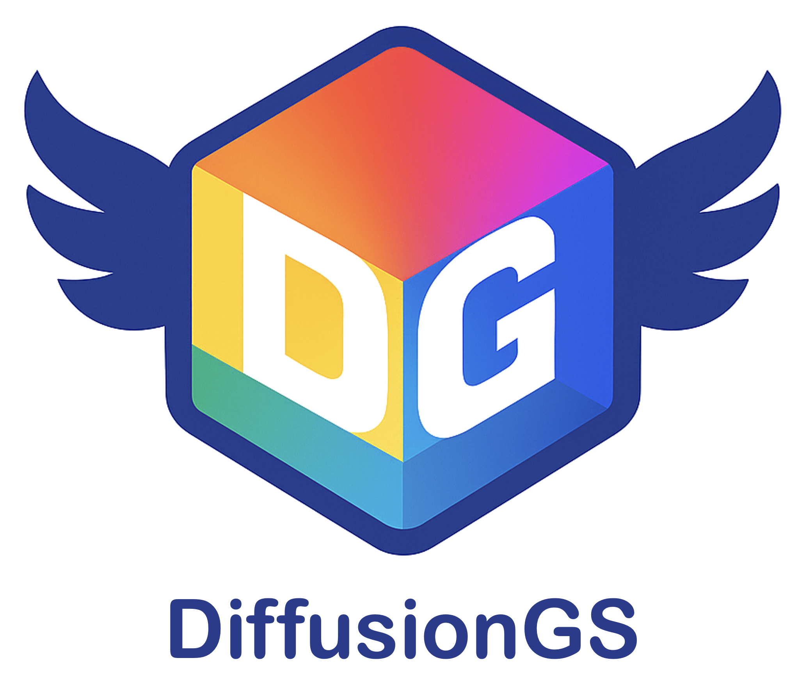 </p>

[](https://arxiv.org/abs/2411.14384)
[](https://zhuanlan.zhihu.com/p/1962623398749372601)
[](https://caiyuanhao1998.github.io/project/DiffusionGS/)
[](https://huggingface.co/datasets/CaiYuanhao/DiffusionGS)
[](https://huggingface.co/CaiYuanhao/DiffusionGS)
[](https://x.com/janusch_patas/status/1859867424859856997)

<h3>Baking Gaussian Splatting into Diffusion Denoiser for Fast and <br> Scalable Single-stage Image-to-3D Generation and Reconstruction</h3> 

</div>


<p align="center">
  
  
  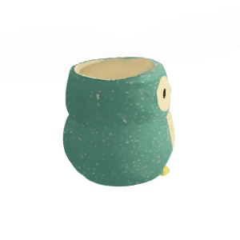
  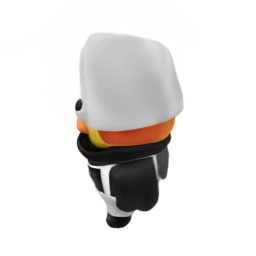
</p>
<p align="center">
  
  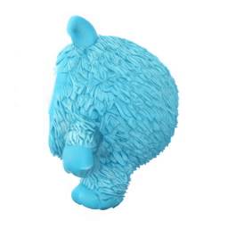
  
  
</p>
<p align="center">
  
  
</p>
<p align="center">
  
  
</p>


### Introduction
This is an implementation of our work "Baking Gaussian Splatting into Diffusion Denoiser for Fast and Scalable Single-stage Image-to-3D Generation and Reconstruction
". The code and checkpoints here is a **re-implementation** and **re-training** and **differs** from the original version developed at Adobe. Our DiffusionGS is single-stage and does not rely on 2D multi-view diffusion model. DiffusionGS can be applied to single-view 3D object generation with mesh exportation and scene reconstruction without using depth estimator in ~6 seconds. If you find our repo useful, please give it a star ⭐ and consider citing our paper. Thank you :)


### News
- **2025.11.20 :** Added mesh exportation code. Feel free to have a try. 💫
- **2025.10.23 :** Add mesh exportion example. Code of this part will also will be released. 🤗
- **2025.10.17 :** Add visual comparisons between Hunyuan-v2.5 and our open-source model.  Our method is over **7.5x** Hunyuan-v2.5 model.  🚀
- **2025.10.10 :** Code and models have been released. Feel free to check and use them.  💫
- **2024.11.22 :** Our [project page](https://caiyuanhao1998.github.io/project/DiffusionGS/) has been built up. Feel free to check the video and interactive generation results on the project page.
- **2024.11.21 :** We upload the prompt image and our generation results to our [hugging face dataset](https://huggingface.co/datasets/CaiYuanhao/DiffusionGS). Feel free to download and make a comparison with your method. 🤗
- **2024.11.20 :** Our paper is on [arxiv](https://arxiv.org/abs/2411.14384) now. 🚀

### Comparison with State-of-the-Art Methods


<details close>
<summary><b>Quantitative Comparison in the Paper</b></summary>

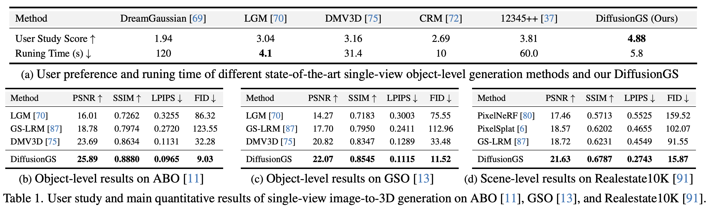

</details>

<details close>
<summary><b>Qualitative Comparison in the paper</b></summary>

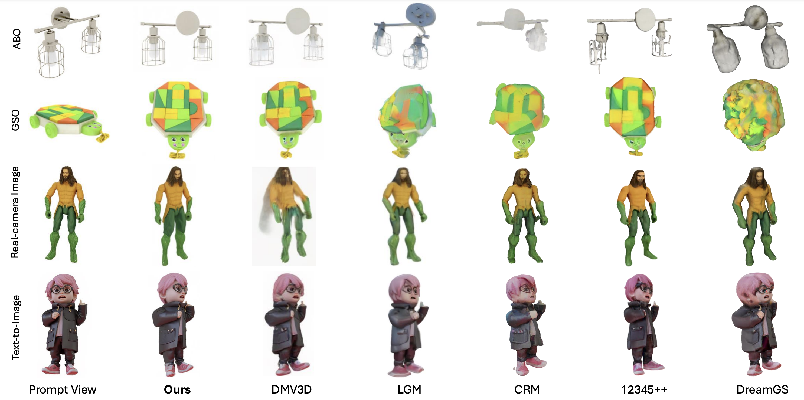

</details>

<details open>
<summary><b>Qualitative Comparison between Hunyuan-v2.5 and Our Open-source Version Model</b></summary>


`Note:` The first row is the prompt image. The second row is Hunyuan-v2.5. The third row is our open-source model. Our model only takes 24s for inference, while Hunyuan-v2.5 takes about 180s. Our model is **7.5x** faster. As for the training cost, our open-source model only takes 16-32 GPUs to train and can be applied on scene-level generation, while Hunyuan-v2.5 is much more expensive.

<!-- ===== Row 1: Prompt Image ===== -->
<table align="center" width="100%" cellspacing="0" cellpadding="0" style="border-collapse:collapse;">
  <tr>
    <td align="center">
      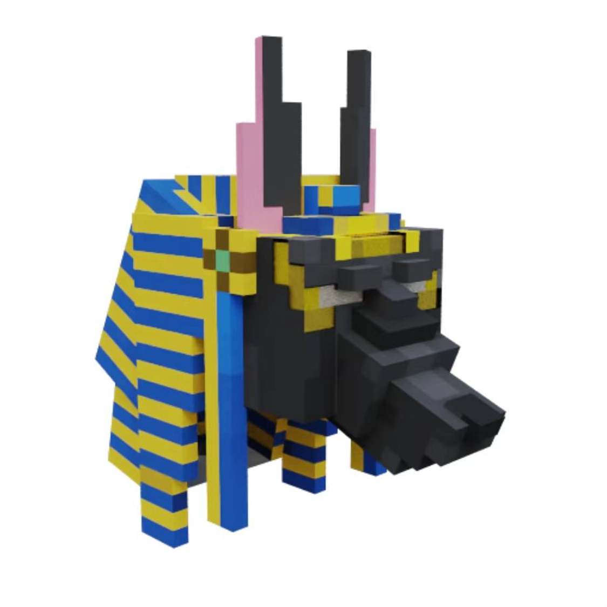
      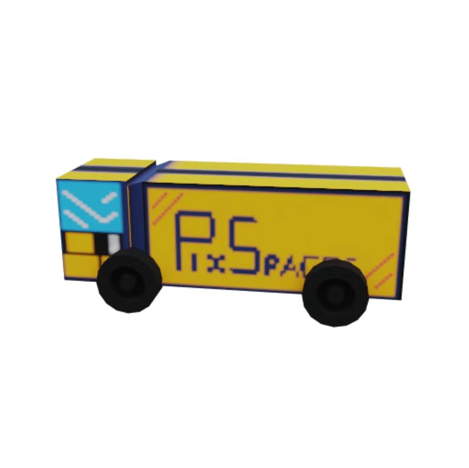
      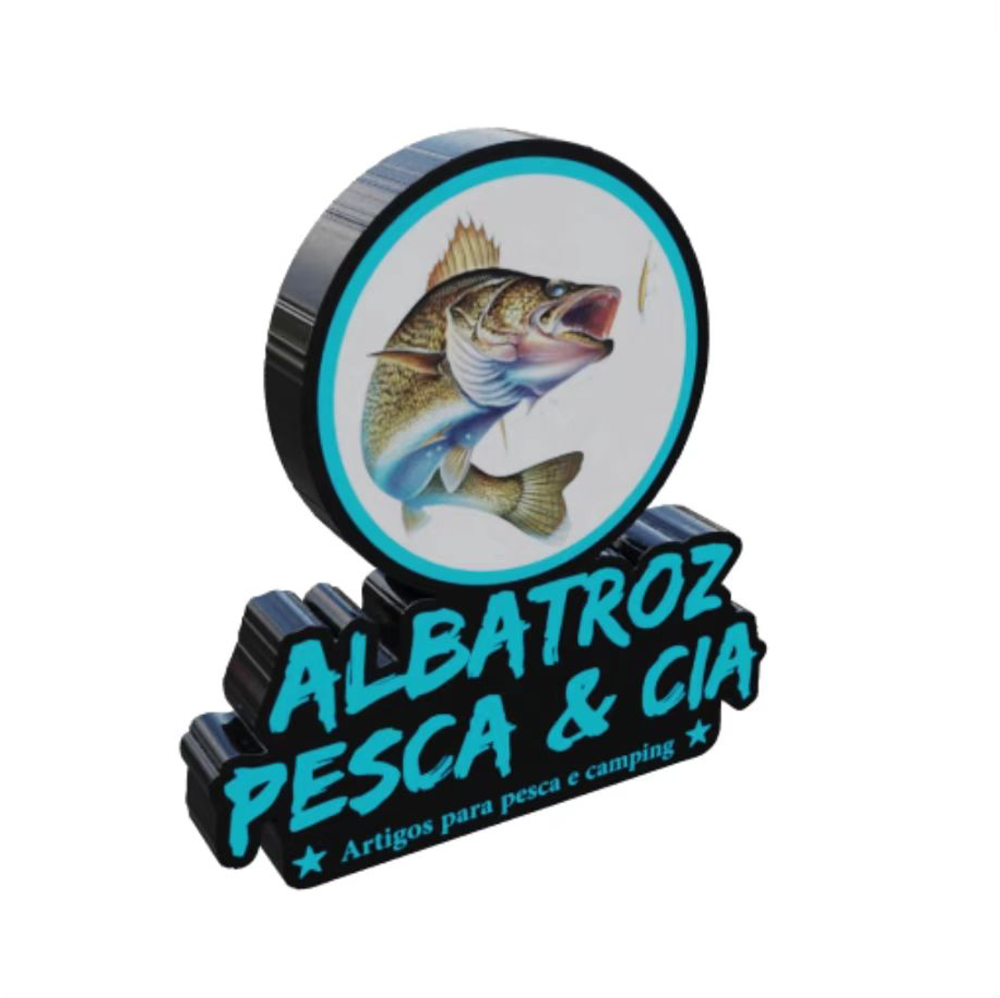
    </td>
  </tr>
  <tr>
    <td align="center" style="padding-top:0px;font-style:italic;">
      Prompt Images at Any Viewpoints
    </td>
  </tr>
</table>
<!-- ===== Row 2: Hunyuan3D ===== -->
<table align="center" width="100%" cellspacing="0" cellpadding="0" style="border-collapse:collapse;">
  <tr>
    <td align="center">
      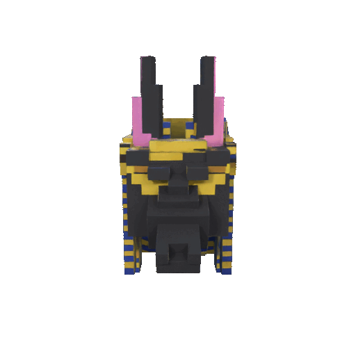
      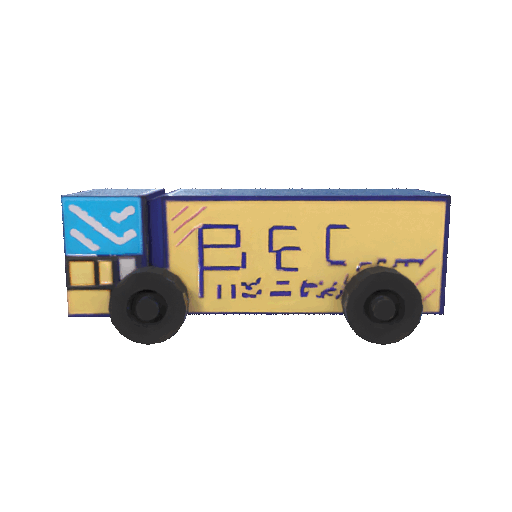
      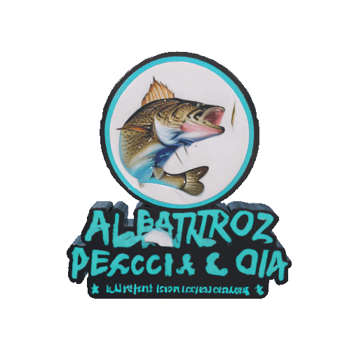
    </td>
  </tr>
  <tr>
    <td align="center" style="padding-top:0px;font-style:italic;">
      Tencent Hunyuan3D-v2.5 (Inference Time: 180 seconds)
    </td>
  </tr>
</table>
<!-- ===== Row 3: DiffusionGS ===== -->
<table align="center" width="100%" cellspacing="0" cellpadding="0" style="border-collapse:collapse;">
  <tr>
    <td align="center">
      
      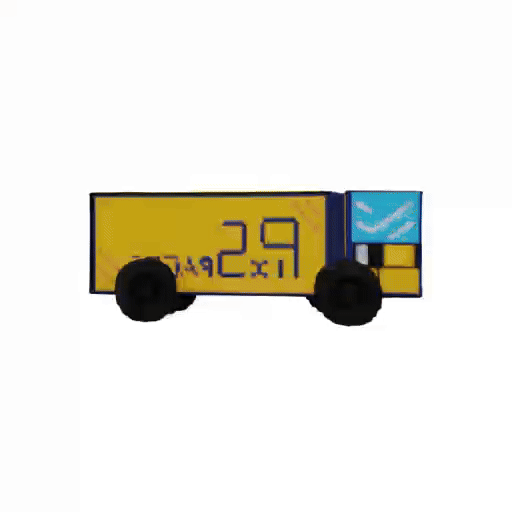
      
    </td>
  </tr>
  <tr>
    <td align="center" style="padding-top:0px;font-style:italic;">
      Our DiffusionGS (Inference Time: 24 seconds)
    </td>
  </tr>
</table>


</details>

&nbsp;

&nbsp;

## 1. Create Environment
```sh
conda create -n diffusiongs python=3.11 -y
conda activate diffusiongs
# conda install -c "nvidia/label/cuda-12.1.1" cudatoolkit
# conda install pytorch==2.5.1 torchvision==0.20.1 torchaudio==2.5.1 pytorch-cuda=12.1 -c pytorch -c nvidia
pip install torch==2.5.1 torchvision==0.20.1
pip install -r requirement.txt
pip install -e submodules/diff-gaussian-rasterization
pip install -e submodules/simple-knn
```

The CUDA extensions require a local CUDA toolkit compatible with your PyTorch CUDA build and a supported C++ compiler. This setup was verified with Python 3.11, PyTorch 2.5.1+cu121, torchvision 0.20.1+cu121, xformers 0.0.29.post1, CUDA 12.1, and GCC/G++ 12 on an RTX A5000. To use that PyTorch build, replace the PyTorch installation command above with:

```sh
pip install torch==2.5.1 torchvision==0.20.1 xformers==0.0.29.post1 --index-url https://download.pytorch.org/whl/cu121
```

`requirement.txt` pins `kiui==0.2.19`: version 0.3.5 fails to import `kiui.op` with `NameError: name 'Union' is not defined`. It also includes the runtime dependencies `typeguard`, `kornia`, `rich`, and `onnxruntime` used by the project and background removal.

&nbsp;

## 2. Quick Demo

### 2.1 Object Generation

For object-centric image-to-3D generation model, we provide a single-line script to use the code:
```shell
python object_demo.py
```
This code will automatically download the model checkpoints and config files from [HuggingFace](https://huggingface.co/CaiYuanhao/DiffusionGS). Or you can manually download them from [this link](https://huggingface.co/CaiYuanhao/DiffusionGS) and set them to a local path.

### 2.2 Scene Generation with Camera Control (Gradio)

Launch the single-image scene generation demo:

```sh
python scene_demo.py
```

Open `http://127.0.0.1:7860`, upload an indoor or outdoor scene image, select a trajectory, and click **Generate scene & video**. A bundled RealEstate10K room image is provided to get started. Images are center cropped to square; scene backgrounds are retained.

The interactive 3D preview updates when camera settings change. Drag to rotate and scroll to zoom. Camera frusta and arrows show both position and viewing direction, including for pure rotation. Pink marks the input camera, gold marks the three generated keyframes, and green arrows show travel direction. The preview, model conditioning, exported cameras, and rendered video all use the same camera path.

There are 16 trajectory presets:

| Camera motion | Presets |
| --- | --- |
| Dolly | Forward, backward |
| Truck | Left, right |
| Pedestal | Up, down |
| Pan | Left, right |
| Tilt | Up, down |
| Orbit | Left, right |
| Combined paths | Crane forward, S-curve, figure eight |
| Fixed camera | Static |

Adjust translation scale, rotation angle, field of view, seed, diffusion steps, video length, and FPS. Both released scene checkpoints (256px and 512px) are supported and downloaded on first use. Only one model is retained on the GPU when switching resolution. The model generates a scene from four conditioning cameras; extra video frames are rendered from that Gaussian scene, without additional diffusion passes. Small motions generally give better scene coverage than large extrapolations.

To select a GPU, use local checkpoints, or store outputs outside the repository:

```sh
CUDA_VISIBLE_DEVICES=0 python scene_demo.py \
  --model-dir /path/to/DiffusionGS \
  --cache-dir /path/to/huggingface-cache \
  --output-dir /path/to/scene-results \
  --server-port 7860
```

The local model directory should contain `scene_ckpt_256.ckpt` and/or `scene_ckpt_512.ckpt` for the resolutions you want to use. Omit `--model-dir` to download from `CaiYuanhao/DiffusionGS`. Use `--server-name 0.0.0.0` for remote access or `--share` to request a Gradio share link.

Each generation saves an H.264 MP4, a Gaussian PLY, the processed input image, camera parameters, and run metadata in a separate output directory. The UI provides video playback, four keyframe views, and PLY/JSON downloads. Camera JSON stores OpenCV **camera-to-world** matrices (+X right, +Y down, +Z forward), pixel-space `(fx, fy, cx, cy)` intrinsics, and the four conditioning frame indices. Translation is normalized using the RealEstate10K convention before applying the selected motion scale. The 3D preview displays the same coordinates with the vertical axis flipped upward for readability.

The demo uses `diffusionGS/pipeline_scene.py` for scene inference without loading training losses. Camera-control interaction and frustum visualization are inspired by [CameraCtrl](https://github.com/hehao13/CameraCtrl); no CameraCtrl model is required. Keep the Pydantic constraint in `requirement.txt` when using Gradio 5.5.0, whose API schema parser is incompatible with Pydantic 2.11+.

Camera geometry checks can be run without loading model checkpoints:

```sh
python -m unittest discover -s tests -v
```

&nbsp;

## 3. Data Preparation

### 3.1 Scene-level Dataset

Download the RealEstate10K dataset from [this link](http://schadenfreude.csail.mit.edu:8000/), which is provided by [pixelSplat](https://github.com/dcharatan/pixelsplat), and `unzip` the zip file and put the data in `YOUR_RAW_DATAPATH`.
Run the following command to preprocess the data into our format.
```bash
python process_data.py --base_path YOUR_RAW_DATAPATH --output_dir YOUR_PROCESSED_DATAPATH --mode ['train' or 'test']
```

### 3.2 Object-level Dataset

We retrained our model using only the Objaverse dataset, which differs from the approaches adopted by Adobe. Additionally, we provide a dataloader that allows you to leverage the open-source G-Objaverse to train object models from scratch.

For prepare the G-objaverse dataset, please follow the instructions in [G-objaverse](https://github.com/modelscope/richdreamer/tree/main/dataset/gobjaverse).

After you download and unzip the dataset. You can see the following structure:
```
gobjaverse
├──0
    ├── 10010
    ├── 10013
    └── ...          
```

After that, you need to prepare a folder that contains 3 json files call `json` like:
```
json
├── test.json ## set a subset for eval
├── train.json ##Use the download script as the training jsons
└── val.json  ## set a subset for eval
```

Then, specify the `local_dir` to this json file and the `image_dir` to the `gobjaverse` file in the config file (`diffusionGS/configs/diffusionGS_rel.yaml`) so that you can train our model using gobjaverse.


&nbsp;

## 4. Evaluation for Single-view Scene Reconstruction

The scene-level evaluation is conducted on the [RealEstate10K](http://schadenfreude.csail.mit.edu:8000/) dataset prepocessed by [pixelSplat](https://github.com/dcharatan/pixelsplat). The model checkpoints are host on [HuggingFace](https://huggingface.co/CaiYuanhao/DiffusionGS/tree/main). 

| Model | PSNR  | SSIM  | LPIPS |
| ----- | ----- | ----- | ----- |
| [Open-DiffusionGS(res256)](https://huggingface.co/CaiYuanhao/DiffusionGS/blob/main/scene_ckpt_256.ckpt) | 21.26 | 0.672 | 0.257 |
| [Open-DiffusionGS(res512)](https://huggingface.co/CaiYuanhao/DiffusionGS/blob/main/scene_ckpt_512.ckpt) | - | - | - |

We use `./extra_files/evaluation_index_re10k.json` to specify the input and target view indice. This json file is originally from [pixelSplat](https://github.com/dcharatan/pixelsplat). 

We only provide evaluation codes for scene as
```bash
bash script/eval.sh
```

This code will evaluate all testsets, and generate the `.pt` for you to caculate metrics, if you want to store the scene videos and gaussians, plese turn `system.save_intermediate_video` to `True` in the config file (`diffusiongs/configs/diffusionGS_scene_eval.yaml`).

After run this codes, the result will specified in `{exp_root_dir}/{name}/{tags}` in the config file.

For provided config, the result will be form like
```
outputs/diffusion_gs_scene_re10k_256_stage1_eval/diffusion-gs-model-scene+lr0.0001/save/it0
├── 0a3b5fb184936a83.pt
├── 0a4cf8d9b81b4c6e.pt
├── ...
```
each `.pt` store the rendered images and gt images for you to calculate metrics. if you turn `system.save_intermediate_video = True` you will see rendered videos of the scene.

If you want to calculate metrics, please run:
```bash
bash cal_metrics.sh
```
after you replace the `exp_root_dir` in `cal_metrics.sh`, you can run this script to calculate metrics.

&nbsp;


## 5. Training
We provide 4 stages training scripts for you to train your own models:
```bash
bash scripts/train_scene_stage1.py # train object model (res256)
bash scripts/train_scene_stage2.py # train object model (res512)
bash scripts/train_obj_stage1.py  # train scene model (res256)
bash scripts/train_obj_stage2.py  # train scene model (res512)
```
Before training, you need to specified your data path in the config files by replacing `local_dir` to your processed `RealEstate10K` (For scene). Or `image_dir` and `local_dir` to the `gobjaverse` file and the prepared json folder (For object).

Note: when you train the second stage model, remember to replace   `shape_model.pretrained_model_name_or_path: ` to the trained first stage checkpoint.

&nbsp;

## 6. Citation
```sh
@inproceedings{diffusiongs,
  title={Baking Gaussian Splatting into Diffusion Denoiser for Fast and Scalable Single-stage Image-to-3D Generation and Reconstruction},
  author={Yuanhao Cai and He Zhang and Kai Zhang and Yixun Liang and Mengwei Ren and Fujun Luan and Qing Liu and Soo Ye Kim and Jianming Zhang and Zhifei Zhang and Yuqian Zhou and Yulun Zhang and Xiaokang Yang and Zhe Lin and Alan Yuille},
  booktitle={ICCV},
  year={2025}
}
```

&nbsp;

## Acknowledgments
We would like to thank the following projects: [DiffSplat](https://github.com/chenguolin/DiffSplat), [CraftsMan3D](https://github.com/HKUST-SAIL/CraftsMan3D), [LVSM](https://github.com/Haian-Jin/LVSM), and [DreamGaussian](https://github.com/dreamgaussian/dreamgaussian)
